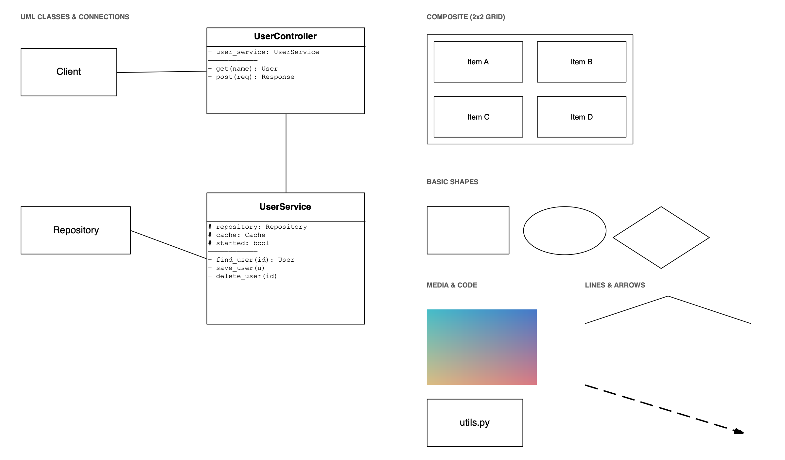

# wxdiagram

**A zoomable shape-and-connector canvas for wxPython.**

[](https://pypi.org/project/wxdiagram/)

`wxdiagram` gives a wxPython application a modern diagram canvas without the
ceremony of `wx.lib.ogl`: shapes, edges, selection, zoom/pan, and JSON
persistence in a small MIT-licensed package.

It began life as `ogl2`, an internal canvas for
[pynsource](https://github.com/abulka/pynsource). The name is now retired; this
repository is the standalone library. See `NOTICE.md` for the `wx.lib.ogl` and
OGLlike attribution.



## Features

- **Canvas with real zoom/pan**: `ZoomIn`, `ZoomOut`, `ZoomTo`, `ZoomReset`,
  `ZoomToFit`, `CenterOn`; Ctrl+wheel and macOS pinch zoom anchored at the
  pointer; drag empty canvas to pan; mouse-wheel scrolling; virtual size tracks
  the diagram so panning cannot wander into empty space.
- **Selection and editing**: marquee select (plain drag on empty canvas),
  Shift/Ctrl add, Esc clear, arrow-key nudge, duplicate, z-order, undo/redo,
  resize handles (Shift = keep aspect ratio), hover ports, and drag
  port-to-shape to connect.
- **Connectors**: attached lines whose endpoints are clipped to the shapes'
  perimeters, so edges always meet the facing sides and re-route when shapes
  move. Explicit lines support arrowheads (start/middle/end), splines, dashed
  pens, and bend control points.
- **Shapes**: resizable rectangles, ellipses, polygons, points, lines, resizable bitmaps, divided
  (UML-style) shapes, labelled blocks, composite shapes with layout
  constraints, non-interactive text labels and movable text captions.
- **JSON persistence**: `Diagram.Save(path)` / `Diagram.Load(path)` or
  `wxdiagram.persistence`; versioned, portable, no pickle.
- **Keyboard**: Delete, Tab cycle, Ctrl+A, Ctrl+C/V.
- **Headless-friendly**: shapes and the diagram model work without showing a
  window.

## Installation

Requires Python 3.10+ and wxPython 4.2+.

```bash
pip install wxdiagram
```

On PyPI: <https://pypi.org/project/wxdiagram/>

or from source with [uv](https://docs.astral.sh/uv/):

```bash
git clone https://github.com/abulka/wxdiagram.git
cd wxdiagram
uv sync
```

## Quickstart

```python
import wx
import wxdiagram

app = wx.App(redirect=False)
frame = wx.Frame(None, title="wxdiagram minimal", size=(600, 400))

canvas = wxdiagram.ShapeCanvas(frame)
canvas.SetDiagram(wxdiagram.Diagram())

shape = wxdiagram.RectangleShape(100, 100, 300, 200)
shape.AddText("hello world")
canvas.InsertShape(shape, 999)

frame.Show()
canvas.update_virtual_size()
app.MainLoop()
```

Connect two blocks with an attached line:

```python
canvas.join_shapes(left_block, right_block)
```

The edge routes through the box perimeters, so it stays correct from any
direction and follows the shapes when they move.

## Demo and examples

```bash
uv run python -m wxdiagram.demo
```

The demo is a kitchen-sink tour: UML-style class boxes, a composite, a
basic-shape gallery, bitmaps, captions, a polyline and an arrowed line. The
File/Edit/Add/Arrange/View menus expose JSON save/load, undo/redo, duplicate,
delete, z-order, image import and zoom.

Small runnable scripts live in `examples/`:

- `minimal_canvas.py` — the 30-line hello world
- `connect_two_blocks.py` — attached-line connections
- `zoom_to_fit.py` — zoom and pan
- `save_load.py` — save and load with JSON

## Scope

`wxdiagram` is a **canvas library**, not a UML framework or a full layout
engine. It deliberately does not include:

- a UML parser or graph model
- application menus, licensing, or PlantUML integration
- a Sugiyama/A* layout engine
- complete `wx.lib.ogl` API parity

Layout is pluggable; an application can run its own layout and hand positions
to the canvas. See `docs/migration-from-wx-lib-ogl.md` for a detailed
comparison with `wx.lib.ogl`.

## Status

Beta (`0.2.0`). The public API is still settling, so pin a version if you
depend on it. pynsource is the main downstream consumer.

## License

MIT, see `LICENSE.md`. The `wx.lib.ogl` and OGLlike attribution is in
`NOTICE.md`.
