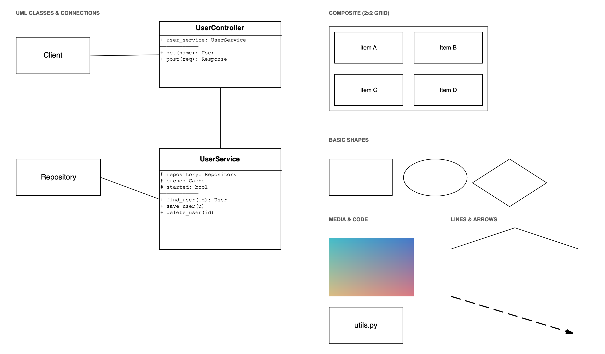
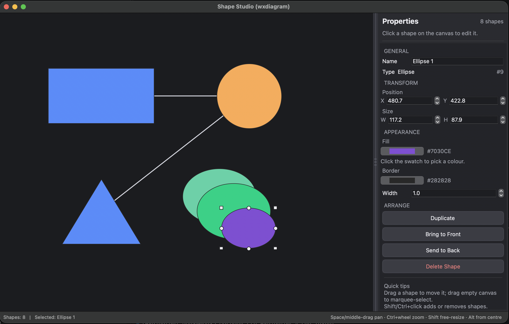
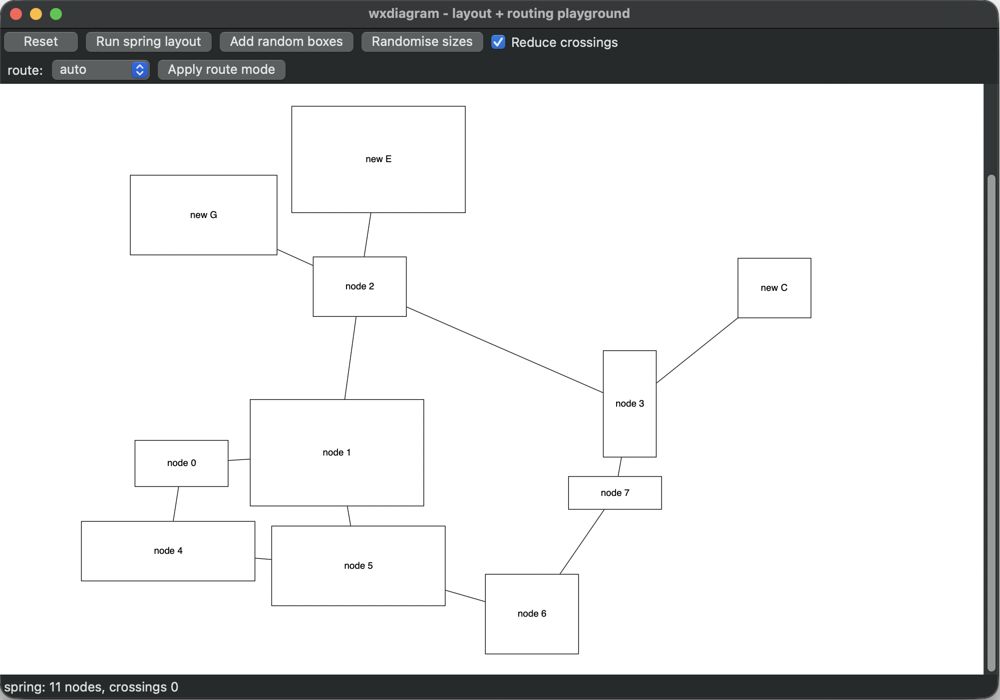

# wxdiagram

**A zoomable shape-and-connector canvas for wxPython.**

`wxdiagram` gives a wxPython application a modern diagram canvas without the
ceremony of `wx.lib.ogl`: shapes, edges, selection, zoom/pan, and JSON
persistence in a small MIT-licensed package.

It began life as `ogl2`, an internal canvas for
[pynsource](https://github.com/abulka/pynsource). The name is now retired; this
is the standalone library. See `NOTICE.md` for the `wx.lib.ogl` and OGLlike
attribution.

## Features

- **Canvas with real zoom/pan** — `ZoomIn`, `ZoomOut`, `ZoomTo`, `ZoomReset`,
  `ZoomToFit`, `CenterOn`; Ctrl+wheel and macOS pinch zoom anchored at the
  pointer; drag empty canvas to pan; mouse-wheel scrolling.
- **Selection and handles** — shift-click multi-select, corner resize handles
  (proportional by default, Shift = free aspect, Alt = from centre), round side
  dots for dragging connections, an optional grid with snap-to-grid, and
  magnetic alignment guides.  Non-connectable shapes also get edge handles.
- **Connectors** — attached lines clipped to shape perimeters, arrowheads,
  splines, dashed pens, bend control points, editable edge labels, and per-edge
  routing modes (`straight`, `auto`, `avoid`, `curved`, `orthogonal`).
- **Shapes** — rectangles, ellipses, polygons (interior hit-testing), points,
  lines, bitmaps, divided shapes, labelled blocks, composites with constraints
  that scale their children, and text labels.
- **Export** — render the diagram to PNG at any scale (`ExportPng`).
- **JSON persistence** — versioned, portable, no pickle.
- **Keyboard** — Delete, Tab cycle, Ctrl+A, Ctrl+C/V.
- **Headless-friendly** — shapes and the diagram model work without a window.

## Demos

Three runnable demos ship with the package:

```bash
uv run python -m wxdiagram.demo        # kitchen sink
uv run python -m wxdiagram.shapesdemo  # Shape Studio-style editor
uv run python -m wxdiagram.layoutdemo  # spring layout + routing playground
```

The helper scripts `./bin/run`, `./bin/run-shapes` and `./bin/run-layout` run
the same three demos. See [Getting started](getting-started.md#run-the-demos)
for what each one covers.

### Kitchen sink



UML-style class boxes, composites, the shape gallery, bitmaps, captions,
edge styles and arrows, with File/Edit/Add/Arrange/View menus.
This image is a canvas export; the other two are window captures.

### Shape editor



Add and edit rectangles, circles, ellipses, triangles and free lines, with a
properties panel, connection dots, grouping, grid/snap and light/dark themes.

### Layout playground



Build a small graph, run the spring layout, randomise sizes and switch edge
routing modes. The screenshot shows the graph after `Run spring layout`.

## Scope

`wxdiagram` is a **canvas library**, not a UML framework or a full layout
engine. It deliberately does not include a UML parser, application menus,
licensing, PlantUML integration, or a Sugiyama/A* layout engine. Layout is
pluggable.

See [Getting started](getting-started.md) and the
[migration guide](migration-from-wx-lib-ogl.md).
